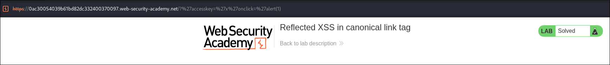
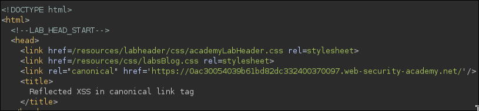

# Lab 07: Reflected XSS in canonical link tag


## 1. Lab Overview

This lab demonstrates a **Reflected Cross-Site Scripting (XSS)** vulnerability in an HTML canonical link tag.

The application reflects user-controlled input into the `href` attribute of an HTML `<link>` element inside the document's `<head>`.

Although the application HTML-encodes angle brackets (`<` and `>`), it does not properly encode single quotes used to delimit the `href` attribute.

This allows an attacker to terminate the existing attribute value and inject additional HTML attributes, including a JavaScript event handler.

The interesting part of this lab is that JavaScript execution is achieved without injecting a new HTML tag.

## 2. Identifying the Vulnerability

By inspecting the HTTP response in Burp Suite, the following HTML element was identified:

```html
<link rel="canonical" href='https://YOUR-LAB-ID.web-security-academy.net/'/>
```

The important observation is that the `href` attribute uses **single quotes** instead of double quotes.

Since single quotes are not properly encoded, user-controlled input can break out of the existing attribute value.

Although angle brackets are encoded, this does not prevent HTML attribute injection.

### Source and Sink

| Component | Description |
|---|---|
| Source | User-controlled input supplied through the URL query string. |
| Sink | The `href` attribute of the canonical `<link>` element. |
| Context | Single-quoted HTML attribute inside the document's `<head>`. |

## 3. Exploitation Technique

The attack uses **HTML attribute injection** combined with the `accesskey` attribute.

Instead of injecting a new HTML element, the payload modifies the existing canonical link element by injecting additional attributes.

### Successful Payload

```text
'accesskey='x'onclick='alert(1)
```

### Payload Breakdown

| Component | Purpose |
|---|---|
| `'` | Terminates the original `href` attribute value. |
| `accesskey='x'` | Assigns the keyboard shortcut `X` to the element. |
| `onclick='alert(1)` | Injects an event handler that executes JavaScript when the element is activated. |

The application's original closing single quote completes the injected `onclick` attribute, while the original `/>` closes the `<link>` element.

### Resulting HTML

Conceptually, the resulting HTML structure contains the injected attributes:

```html
<link
    rel="canonical"
    href='https://YOUR-LAB-ID.web-security-academy.net/'
    accesskey='x'
    onclick='alert(1)'
/>
```

No additional HTML tag is required.

## 4. Triggering JavaScript Execution

A canonical link is normally located inside the HTML `<head>` and is not displayed as a visible or clickable element.

To trigger the injected event handler, the `accesskey` attribute is used to associate the element with a keyboard shortcut.

After loading the crafted URL in Google Chrome, pressing the appropriate keyboard combination activates the element and triggers its `onclick` event.

The lab provided these keyboard combinations:

- `ALT + SHIFT + X`
- `CTRL + ALT + X`
- `ALT + X`

The successful execution displays the JavaScript alert.

## 5. Screenshots

### 5.1 Lab Solved

The screenshot below shows the lab web-url along with the payload which was solved after triggering the injected JavaScript.



### 5.2 Identifying the Vulnerable Canonical Link

The HTTP response reveals the canonical link element inside the document's `<head>`.

Notice that the `href` attribute is enclosed in single quotes. This is the attribute context that makes the injection possible.



## 6. Key Concepts Learned

- Reflected Cross-Site Scripting (XSS)
- HTML attribute injection
- Attribute breakout using single quotes
- HTML attribute delimiters
- Canonical link tags
- `accesskey` attribute
- `onclick` event handler
- Keyboard-triggered JavaScript execution
- Incomplete output encoding

## 7. Root Cause

The application reflects user-controlled input into a single-quoted HTML attribute without properly encoding single quotes.

Although angle brackets are escaped, this protection is insufficient because an attacker can still terminate the existing attribute and inject additional attributes.

The vulnerability exists because the application does not apply appropriate context-aware output encoding for the HTML attribute context.

## 8. Security Takeaways

- HTML encoding must be appropriate for the output context.
- Both single-quoted and double-quoted attribute values must be handled safely.
- Preventing HTML tag injection does not automatically prevent attribute injection.
- User-controlled input should not be inserted into HTML attributes without proper contextual encoding.
- Applications should use secure templating mechanisms and appropriate output encoding to prevent XSS.

## 9. Conclusion

This lab demonstrated how an attacker can exploit an existing HTML element, inject a keyboard-accessible event handler, and execute JavaScript without introducing a new HTML tag.

The key lesson is that **blocking angle brackets is not enough to prevent XSS**. Attribute delimiters must also be handled correctly, and output encoding must match the context in which user-controlled input is inserted.
