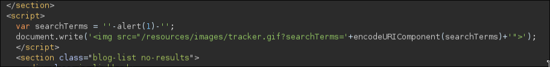

# Lab 09: Reflected XSS into a JavaScript String with Angle Brackets HTML-Encoded


## 1. Lab Overview

This lab demonstrates a **Reflected Cross-Site Scripting (XSS)** vulnerability in the search query tracking functionality of a web application.

The application reflects user-controlled search input inside an existing JavaScript string. Although angle brackets (`<` and `>`) are HTML-encoded, preventing the injection of new HTML elements, the application does not properly prevent the termination of the existing JavaScript string.

This allows an attacker to break out of the string and inject a JavaScript expression that executes the `alert()` function.

Unlike previous labs that involved injecting HTML elements or terminating the surrounding script element, this technique executes JavaScript directly within the existing JavaScript context.

## 2. Identifying the Vulnerability

By inspecting the HTTP response using Burp Suite, the search query was found to be reflected inside a JavaScript variable.

The relevant JavaScript structure was:

```javascript
var searchTerms = 'USER_INPUT';
```

The input is placed inside a single-quoted JavaScript string.

Since angle brackets are HTML-encoded, injecting HTML elements such as `<script>` or `` is not the intended approach.

Instead, the vulnerability can be exploited by terminating the existing JavaScript string using a single quote and introducing a JavaScript expression.

### Source and Sink

| Component | Description |
|---|---|
| Source | User-controlled search query supplied through the URL. |
| Sink | Reflected JavaScript code inside the HTML `<script>` element. |
| Context | Single-quoted JavaScript string. |

### Screenshot: JavaScript Source

The screenshot below shows how the application assigns the reflected search query to the `searchTerms` variable.



## 3. Exploitation Technique

The attack involves breaking out of the existing JavaScript string using a single quote and executing JavaScript through an arithmetic expression.

### Successful Payload

```javascript
'-alert(1)-'
```

### Payload Breakdown

| Payload Component | Purpose |
|---|---|
| `'` | Terminates the original JavaScript string. |
| `-` | Introduces a subtraction expression. |
| `alert(1)` | Executes JavaScript and displays an alert. |
| `-` | Continues the subtraction expression. |
| `'` | Starts another string literal to maintain valid JavaScript syntax. |

The payload does not require injecting a new HTML element. It uses JavaScript expression evaluation to execute the injected function.

## 4. How the Browser Interprets the Payload

The original JavaScript structure is:

```javascript
var searchTerms = 'USER_INPUT';
```

After injecting the payload:

```javascript
'-alert(1)-'
```

The resulting JavaScript becomes:

```javascript
var searchTerms = ''-alert(1)-'';
```

The browser interprets this as a valid JavaScript expression:

- `''` represents an empty string.
- `-` acts as the subtraction operator.
- `alert(1)` executes during expression evaluation.
- The final `-''` completes the expression.

JavaScript evaluates the expression from left to right. When it reaches `alert(1)`, the alert function executes.

The expression may produce a `NaN` result after execution, but this does not prevent the alert from appearing.

### Important Observation

Unlike techniques that terminate the surrounding HTML `<script>` element, this approach executes JavaScript directly within the existing script block.

The application prevents HTML element injection through angle-bracket encoding, but it does not adequately protect the JavaScript string context.

## 5. Screenshots

### 5.1 Lab Solved

The screenshot below shows the successful completion of the lab after executing the injected JavaScript expression.


### 5.2 Identifying the JavaScript Context

The HTTP response reveals the JavaScript code where the search query is reflected.

Notice that the `searchTerms` variable uses a single-quoted string, which creates the injection context.


## 6. Key Concepts Learned

- Reflected Cross-Site Scripting (XSS)
- JavaScript string context
- Breaking out of JavaScript string literals
- Single-quote injection
- JavaScript arithmetic expressions
- Operator-based JavaScript execution
- HTML encoding
- Context-dependent XSS exploitation

## 7. Root Cause

The application reflects user-controlled input inside a JavaScript string without properly preventing the termination of that string.

Although angle brackets are HTML-encoded, this protection does not prevent JavaScript injection within an existing script block.

The application fails to apply appropriate context-specific protection to the reflected input.

## 8. Security Takeaways

- HTML encoding alone does not prevent JavaScript-context XSS.
- Applications must apply context-aware output encoding.
- User-controlled input should not be directly inserted into executable JavaScript.
- JavaScript string delimiters must be handled safely.
- Secure templating and safe data serialization should be preferred over manually constructing JavaScript using user input.

## 9. Conclusion

This lab demonstrated how an attacker can escape an existing JavaScript string using a single quote and execute JavaScript through an arithmetic expression without injecting any new HTML elements.

The key lesson is that **HTML encoding and JavaScript string protection address different contexts**. Protecting one context does not automatically secure another.
