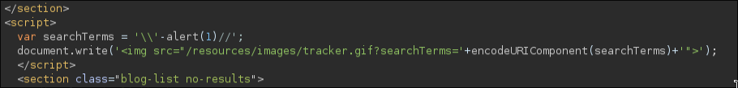

# Lab 10: Reflected XSS into a JavaScript String with Angle Brackets and Double Quotes HTML-Encoded and Single Quotes Escaped


## 1. Lab Overview

This lab demonstrates a **Reflected Cross-Site Scripting (XSS)** vulnerability in the search query tracking functionality of a web application.

The application reflects user-controlled search input inside an existing JavaScript string. It applies multiple security measures:

- Angle brackets (`<` and `>`) are HTML-encoded.
- Double quotes (`"`) are HTML-encoded.
- Single quotes (`'`) are escaped using backslashes.

Although these protections attempt to prevent JavaScript injection, the application fails to properly handle user-supplied backslashes.

This creates an opportunity to exploit the JavaScript string escaping mechanism through **backslash neutralization**.

The key concept is that escaping a single quote is not sufficient if an attacker can manipulate the backslashes used in that escaping process.

## 2. Identifying the Vulnerability

By inspecting the HTTP response in Burp Suite, the search query was found to be reflected inside a JavaScript variable.

The relevant JavaScript structure was:

```javascript
var searchTerms = 'USER_INPUT';
```

The application attempts to prevent breaking out of the JavaScript string by adding a backslash before injected single quotes.

A normal payload such as:

```javascript
';alert(1)//
```

would have its single quote escaped by the application, preventing it from terminating the original JavaScript string.

However, the application does not properly handle additional backslashes supplied by the user.

### Source and Sink

| Component | Description |
|---|---|
| Source | User-controlled search query supplied through the URL. |
| Sink | Reflected JavaScript code inside the HTML `<script>` element. |
| Context | Single-quoted JavaScript string. |

### Screenshot: JavaScript Source

The screenshot below shows the reflected JavaScript code and how the application handles the search query.



## 3. Exploitation Technique: Backslash Neutralization

Instead of directly attempting to terminate the JavaScript string, an additional backslash is supplied to neutralize the backslash introduced by the application.

### Successful Payload

```javascript
\'-alert(1)//
```

### Payload Breakdown

| Payload Component | Purpose |
|---|---|
| `\` | Supplies an additional backslash to interact with the application's escaping mechanism. |
| `'` | Becomes an unescaped string terminator after the two backslashes are interpreted together. |
| `-` | Introduces a subtraction expression. |
| `alert(1)` | Executes JavaScript and displays an alert. |
| `//` | Comments out the remaining JavaScript on the line. |

The important part of this technique is the interaction between the attacker-supplied backslash and the backslash added by the application.

## 4. Understanding How the Browser Interprets the Payload

The original JavaScript structure is:

```javascript
var searchTerms = 'USER_INPUT';
```

The application attempts to escape single quotes by adding a backslash.

When the payload is submitted, the application-generated JavaScript source becomes approximately:

```javascript
var searchTerms = '\\'-alert(1)//';
```

The JavaScript parser interprets the characters as follows:

1. The first two backslashes (`\\`) represent one literal backslash inside the JavaScript string.
2. The following single quote (`'`) terminates the original JavaScript string.
3. The subtraction operator (`-`) introduces a JavaScript expression.
4. `alert(1)` executes during expression evaluation.
5. `//` comments out the remaining characters on that line.

The alert executes because the application-generated backslash no longer escapes the single quote.

### Important Observation: Backslash Escaping

A backslash is itself an escape character in JavaScript.

When two consecutive backslashes appear inside a JavaScript string, they are interpreted as one literal backslash.

Therefore, the additional backslash supplied by the attacker changes how the application's quote-escaping mechanism behaves.

This allows the attacker to terminate the original string and execute JavaScript without injecting any HTML elements.

## 5. Screenshots

### 5.1 Lab Solved

The screenshot below shows the successful completion of the lab after executing the injected JavaScript expression.


### 5.2 Identifying the JavaScript Context

The HTTP response reveals the reflected JavaScript code.

Notice the two consecutive backslashes before the single quote in the resulting JavaScript source. This demonstrates how the additional backslash neutralizes the application's escaping mechanism.


## 6. Key Concepts Learned

- Reflected Cross-Site Scripting (XSS)
- JavaScript string context
- Backslash neutralization
- JavaScript escape sequences
- Single-quote escaping
- Inconsistent input escaping
- JavaScript arithmetic expressions
- Breaking out of JavaScript string literals
- Context-dependent output encoding

## 7. Root Cause

The application attempts to protect the JavaScript string by escaping single quotes but fails to properly handle backslashes supplied by the user.

This inconsistent escaping allows an attacker to manipulate the resulting JavaScript source and neutralize the application's quote-escaping mechanism.

The underlying problem is that the application relies on incomplete character escaping instead of applying appropriate context-aware output encoding.

## 8. Security Takeaways

- Escaping single quotes without correctly handling backslashes can introduce vulnerabilities.
- JavaScript escape sequences must be handled consistently.
- HTML encoding alone does not prevent JavaScript-context XSS.
- Applications should avoid directly embedding untrusted input inside executable JavaScript.
- Context-aware output encoding should be applied based on the output context.
- Safe data serialization and non-executable data contexts should be preferred over manually constructing JavaScript using user input.

## 9. Conclusion

This lab demonstrated how backslash neutralization can bypass an application's single-quote escaping mechanism, allowing an attacker to break out of an existing JavaScript string and execute JavaScript.

The key lesson is that **escaping dangerous characters individually is not enough when the escaping mechanism itself can be manipulated**. Developers must handle backslashes and string delimiters consistently and use context-aware output encoding to prevent JavaScript-context XSS.
