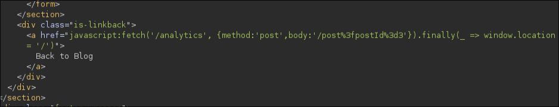
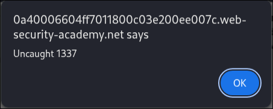
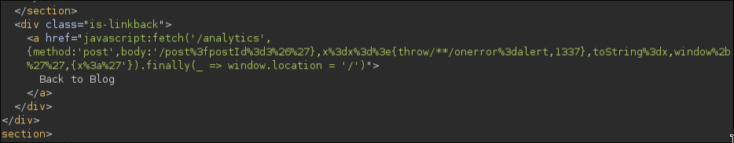
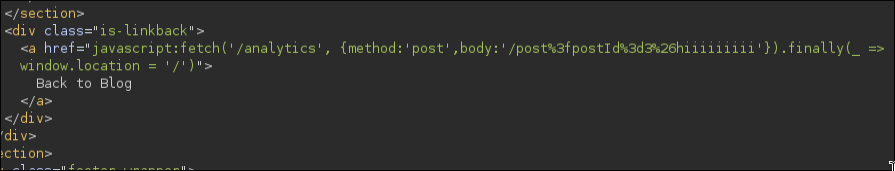

# Lab 11: Reflected XSS in a JavaScript URL with Some Characters Blocked


## 1. Lab Overview

This lab demonstrates an **Expert-level Reflected Cross-Site Scripting (XSS)** vulnerability in a JavaScript URL.

The application reflects user-controlled input into a JavaScript URL associated with the **Back to Blog** link. However, the application blocks certain characters in an attempt to prevent JavaScript injection.

The objective is to execute the `alert()` function with the value `1337` somewhere in its message.

Unlike the previous labs, this challenge does not provide a conventional search box or an obvious JavaScript injection point. It requires understanding how the existing JavaScript URL works, identifying how user input reaches it, and constructing a payload that executes despite character restrictions.

The main techniques explored in this lab are:

- JavaScript URL injection.
- JavaScript expression evaluation.
- Arrow functions without parentheses around a single parameter.
- The `throw` statement and exception handling.
- Assigning `alert` to the global `onerror` handler.
- Overriding the `toString()` method.
- Triggering function execution through JavaScript type coercion.
- Working around blocked parentheses and spaces.

## 2. My Initial Approach

### 2.1 Finding an Injection Point

Initially, I noticed that the lab did not have a conventional search box.

Instead, each blog post contained a comment section.

Since this was the only obvious way to submit user-controlled input, I posted a comment and inspected the resulting HTTP traffic using Burp Suite.

I expected to find a JavaScript `<script>` element that processed my comment.

However, something unexpected happened.

**There was no `<script>` element parsing my comment.**

This confused me because I was trying to understand how I could inject a JavaScript payload into the browser without an existing script element.

I initially focused on finding a conventional reflected JavaScript context, but that was not where the vulnerability existed.

### 2.2 Discovering the JavaScript URL

While inspecting the application's HTML, I noticed the following link:

```html
<a href="javascript:fetch('/analytics', ...).finally(_ => window.location = '/')">
    Back to Blog
</a>
```

This caught my attention because the `href` attribute started with:

```javascript
javascript:
```

This meant the link was not navigating to a normal URL. Instead, clicking it would execute the JavaScript expression inside the `href` attribute.

That was the important realization:

**I did not need to inject a new `<script>` element. I needed to understand and manipulate the JavaScript URL that already existed.**

### Screenshot: Original JavaScript URL

The following screenshot shows the original `Back to Blog` anchor and its JavaScript URL.



## 3. Understanding the Existing JavaScript

After identifying the JavaScript URL, I examined its structure more closely.

The original link contained a `fetch()` request:

```javascript
javascript:fetch('/analytics', {
    method: 'post',
    body: '/post%3fpostId%3d3'
}).finally(_ => window.location = '/')
```

### 3.1 Understanding `fetch()`

The `fetch()` function accepts a resource URL and an optional configuration object.

In this case, the application uses:

| Component | Purpose |
|---|---|
| `fetch('/analytics', ...)` | Sends a request to the `/analytics` endpoint. |
| `method: 'post'` | Specifies that the request uses the POST method. |
| `body: '/post%3fpostId%3d3'` | Supplies the request body. |
| `.finally(...)` | Executes its callback after the fetch promise settles. |
| `window.location = '/'` | Navigates the browser back to the home page. |

The important part was the `body` property.

It contained a string representing a post URL. This provided an opportunity to introduce additional JavaScript expressions by carefully manipulating the string's closing delimiter.

### 3.2 Understanding the Character Restrictions

During my investigation, I discovered two important restrictions:

1. Parentheses `()` were encoded or blocked.
2. Spaces were not allowed.

This meant that conventional JavaScript payloads involving function calls were not suitable.

For example:

```javascript
alert(1337)
```

could not be used directly because it required parentheses.

I therefore needed a way to execute JavaScript without using conventional function-call syntax.

## 4. Understanding JavaScript Function Execution Without Parentheses

Before constructing the final payload, I explored alternative JavaScript execution techniques.

### 4.1 Using the `throw` Statement

The `throw` statement raises an exception in JavaScript.

For example:

```javascript
throw 1;
```

This produces an uncaught exception containing the value `1`.

An important property is that the `throw` statement does not require parentheses.

I also discovered that an exception can interact with the browser's global `onerror` handler.

For example:

```javascript
onerror = alert;
throw 1337;
```

Here:

1. `onerror = alert` assigns the `alert` function to the global error handler.
2. `throw 1337` raises an uncaught exception.
3. The browser invokes the error handler.
4. The `alert` function receives the error message.

This provides a way to trigger an alert without directly writing `alert(1337)`.

The successful lab execution displayed:

```text
Uncaught 1337
```

### Screenshot: Successful JavaScript Execution



## 5. Understanding Arrow Functions

The next challenge was executing the `throw` statement inside a function.

A normal function declaration or function expression requires parentheses around its parameters.

However, JavaScript arrow functions have a useful syntax feature:

**When an arrow function has exactly one parameter, its parameter parentheses can be omitted.**

For example:

```javascript
x => {
    throw 1;
}
```

This allowed me to define a function without using parentheses around its parameter.

The function body could then contain the exception-handling logic:

```javascript
x => {
    throw onerror = alert, 1337;
}
```

The comma operator evaluates its expressions from left to right:

1. `onerror = alert` assigns the alert function to the error handler.
2. `1337` becomes the value thrown by the `throw` statement.

This was a significant breakthrough because it provided a way to construct the required execution logic without conventional function-call parentheses.

## 6. Triggering the Function Through `toString()`

Defining an arrow function was not enough. I still needed the browser to execute it.

The next realization came from JavaScript's type coercion.

### 6.1 Understanding `toString()`

JavaScript objects can be converted into primitive values.

One common way to trigger this conversion is concatenating an object with a string.

For example:

```javascript
window + ''
```

When JavaScript evaluates this expression, it needs to convert the `window` object into a primitive value.

During this process, JavaScript can invoke the object's `toString()` method.

This led to another important idea:

**What if I could replace `window.toString` with my arrow function?**

### 6.2 Overriding `toString()`

JavaScript allows methods and properties to be assigned dynamically.

For example:

```javascript
window.toString = x => {
    throw onerror = alert, 1337;
};
```

Now, when the browser attempts to convert `window` into a string, the assigned function can execute.

The expression:

```javascript
window + ''
```

triggers the conversion process, which invokes the overridden `toString()` method.

The function executes the `throw` statement, and the global error handler invokes `alert`.

This provided the execution mechanism needed for the final payload.

## 7. Constructing the Final Payload

After understanding the JavaScript behavior, I returned to the original `fetch()` expression.

The application provided a JavaScript URL containing a string inside the `body` property.

The goal was to escape that string, introduce the required JavaScript expressions, and preserve enough of the original syntax for the browser to execute the payload.

There were still two restrictions:

- Parentheses were blocked or encoded.
- Spaces were not allowed.

To work around these restrictions:

- I used an arrow function with a single parameter, avoiding parameter parentheses.
- I used `/**/` as a comment separator instead of a space.
- I used the `throw` statement to trigger the global error handler.
- I assigned the arrow function to `toString`.
- I used `window + ''` to trigger string conversion.

### 7.1 Successful Payload

The following is the final JavaScript URL payload, as reflected in the application's HTML:

```javascript
javascript:fetch('/analytics',{method:'post',body:'/post%3fpostId%3d3%26%27),x%3dx%3d%3e{throw/**/onerror%3dalert,1337},toString%3dx,window%2b%27%27,(x%3a%27')}).finally(_=>window.location='/')
```

The important encoded characters include:

| Encoded Character | Decoded Character |
|---|---|
| `%3f` | `?` |
| `%3d` | `=` |
| `%26` | `&` |
| `%27` | `'` |
| `%3e` | `>` |
| `%2b` | `+` |
| `%3a` | `:` |

The encoding allows the payload to be placed inside the existing request-body string while controlling how the resulting JavaScript is interpreted.

### 7.2 Payload Components

| Component | Purpose |
|---|---|
| `javascript:` | Executes the JavaScript expression when the link is activated. |
| `fetch('/analytics', ...)` | Preserves the application's original analytics request. |
| `body:` | Provides the string context used as the injection point. |
| `%26%27` | Encodes the characters needed to introduce the next part of the injected expression. |
| `x%3dx%3d%3e` | Encodes the arrow-function assignment structure. |
| `throw` | Raises an exception without requiring a function call. |
| `/**/` | Separates tokens without introducing a space. |
| `onerror%3dalert` | Assigns the alert function to the global error handler. |
| `1337` | The value thrown, which appears in the resulting error message. |
| `toString%3dx` | Assigns the arrow function to `toString`. |
| `window%2b%27%27` | Triggers object-to-string conversion. |
| `.finally(...)` | Preserves the original navigation behavior after the fetch promise settles. |

### Screenshot: Final Injected JavaScript URL

The following screenshot shows the final reflected anchor element containing the crafted payload.



## 8. Testing and Refining the Payload

The final solution was not obtained immediately.

I first experimented with the request body and observed how different characters were encoded and reflected.

One of the intermediate attempts used additional characters in the body to investigate how the application processed the input.

This helped identify the restrictions and understand where the original string could be terminated.

### Intermediate Attempt



The intermediate testing helped establish the following:

- The injection point was inside the `fetch()` request's `body` property.
- Parentheses could not be used directly.
- Spaces were restricted.
- JavaScript expressions could still be introduced through the string context.
- Arrow functions and exception handling provided an alternative execution path.

After refining the payload, the final JavaScript URL successfully triggered the alert.

## 9. Final Execution Flow

The complete attack can be understood as the following sequence:

1. The application renders a `Back to Blog` link containing a `javascript:` URL.
2. The JavaScript URL contains a `fetch()` request with a user-influenced request-body value.
3. The injected input escapes the original string context and introduces additional JavaScript expressions.
4. An arrow function is created without parentheses around its single parameter.
5. The function assigns `alert` to the global `onerror` handler.
6. The `throw` statement raises the value `1337`.
7. The arrow function is assigned to the `toString` method.
8. The `window + ''` expression triggers object-to-string conversion.
9. The overridden `toString()` method executes.
10. The exception reaches the global error handler, which invokes `alert`.
11. The browser displays the error message containing `1337`.

The lab is successfully solved when the user clicks **Back to Blog** and the alert is triggered.

## 10. Root Cause

The root cause is the unsafe construction of a JavaScript URL using application-controlled and user-influenced data.

The application places data inside an executable JavaScript expression and relies on character restrictions to prevent injection.

However, blocking individual characters is not a reliable defense against JavaScript injection.

An attacker can use alternative JavaScript language features, expression evaluation, type coercion, and exception handling to construct executable code without relying on conventional syntax.

The underlying security issue is the use of untrusted data in an executable JavaScript context.

## 11. Security Takeaways

- JavaScript URLs can execute code when their associated links are activated.
- A conventional `<script>` element is not required for JavaScript execution.
- Blocking parentheses and spaces does not guarantee protection against JavaScript injection.
- Arrow functions can omit parentheses around a single parameter.
- The `throw` statement can raise exceptions without using a function call.
- The global `onerror` handler can receive uncaught exception information.
- The `toString()` method can be invoked during JavaScript type coercion.
- String concatenation can trigger object-to-primitive conversion.
- JavaScript's built-in language features can be combined to create execution paths that are not immediately obvious.
- Applications should avoid constructing executable JavaScript URLs using untrusted input.

## 12. Conclusion

This lab was particularly interesting because the initial injection point was not obvious.

I started by looking for a conventional reflected input or a `<script>` element, but the actual vulnerability was inside an existing JavaScript URL in the `Back to Blog` link.

The most important realization was that I did not need conventional `alert()` function-call syntax.

By understanding arrow functions, the `throw` statement, global exception handling, and JavaScript type coercion, I was able to construct a payload that worked despite the application's character restrictions.

**The biggest takeaway from this lab is that understanding JavaScript execution is more important than memorizing XSS payloads.** When conventional syntax is blocked, understanding the language's underlying behavior can reveal alternative execution paths.
