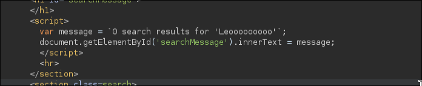
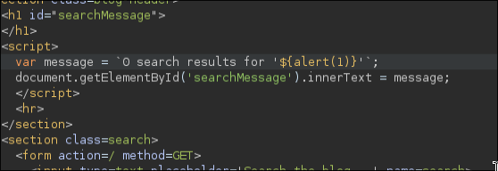

# Lab 12: Reflected XSS into a Template Literal with Angle Brackets, Single, Double Quotes, Backslash and Backticks Unicode-Escaped


## 1. Lab Overview

This lab demonstrates a **Reflected Cross-Site Scripting (XSS)** vulnerability in the search functionality of a web application.

The application reflects the user-provided search term inside a JavaScript template literal. It applies several security measures:

- Angle brackets (`<` and `>`) are HTML-encoded.
- Single quotes (`'`) are HTML-encoded.
- Double quotes (`"`) are HTML-encoded.
- Backslashes (`\`) and backticks (`` ` ``) are Unicode-escaped.

Despite these protections, the application does not prevent the use of JavaScript template literal expressions.

The vulnerability can be exploited by injecting a JavaScript expression using the `${...}` syntax. This allows JavaScript to execute directly inside the existing template literal without needing to terminate it.

The objective was to execute the `alert()` function through the reflected search input.

## 2. Identifying the Vulnerable Code

After examining the application's HTML response, I identified the following JavaScript:

```javascript
var message = `0 search results for '${searchTerm}'`;
document.getElementById('searchMessage').innerText = message;
```

The application uses a JavaScript template literal to construct the search result message.

The template literal is enclosed in backticks, and the user-controlled search term is inserted directly into it.

For example, when searching for:

```text
Leooooooo
```

The resulting JavaScript becomes:

```javascript
var message = `0 search results for 'Leooooooo'`;
document.getElementById('searchMessage').innerText = message;
```

The application then assigns the generated message to the `innerText` property of the HTML element with the ID `searchMessage`.

This confirmed that the search term was reflected inside JavaScript code.

### Screenshot: Original JavaScript Structure

The following screenshot shows the original JavaScript structure with a normal search term reflected inside the template literal.



## 3. Understanding JavaScript Template Literals

JavaScript supports three common ways to define strings:

- Single quotes: `'Hello'`
- Double quotes: `"Hello"`
- Backticks: `` `Hello` ``

Strings defined using backticks are called **template literals**.

Unlike ordinary strings, template literals support embedded JavaScript expressions using the `${...}` syntax.

For example:

```javascript
var name = 'Leo';
var message = `Welcome, ${name}`;
```

The browser evaluates the expression inside `${name}` and inserts its value into the resulting string.

The output is:

```text
Welcome, Leo
```

This means that `${...}` is not treated as ordinary text. JavaScript evaluates whatever valid expression is placed inside those braces.

## 4. Understanding the Vulnerability

The vulnerable code was:

```javascript
var message = `0 search results for '${searchTerm}'`;
```

The application inserted the search term directly inside the template literal.

Although the application attempted to protect the input by encoding or escaping several characters, it did not prevent the use of the `${...}` expression syntax.

An attacker could therefore provide an input containing a JavaScript expression.

The important observation was that it was not necessary to terminate the existing template literal using a backtick.

Instead, the existing template literal itself could be used to execute an embedded JavaScript expression.

## 5. Final Payload

The successful payload was:

```javascript
${alert(1)}
```

I entered this payload into the application's search field.

When the application reflected the input, the resulting JavaScript became:

```javascript
var message = `0 search results for '${alert(1)}'`;
document.getElementById('searchMessage').innerText = message;
```

The injected expression is evaluated as part of the template literal.

### Screenshot: Payload Reflected Inside the Template Literal

The screenshot below shows the injected `${alert(1)}` expression inside the reflected JavaScript template literal.



## 6. How the Payload Executes

Let's break down the payload:

```javascript
${alert(1)}
```

| Component | Explanation |
|---|---|
| `${` | Starts an embedded JavaScript expression inside the template literal. |
| `alert(1)` | Calls the JavaScript alert function with the value `1`. |
| `}` | Closes the embedded expression. |

### Execution Process

1. The browser processes the JavaScript containing the template literal.
2. It encounters `${` inside the template literal.
3. JavaScript recognizes the content between `${` and `}` as an expression.
4. It evaluates `alert(1)`.
5. The alert dialog appears in the browser.
6. The expression returns `undefined`, which is converted into a string and included in the resulting message.
7. The completed message is assigned to the `innerText` property.

The important point is that JavaScript evaluates embedded expressions while processing the template literal.

Therefore, the injected JavaScript executes before the resulting message is assigned to the HTML element.

## 7. Why Was It Not Necessary to Terminate the Template Literal?

This is the most important concept in this lab.

In a normal JavaScript string, such as:

```javascript
var message = 'USER_INPUT';
```

An attacker generally needs to escape the surrounding string context to inject JavaScript.

However, template literals already support JavaScript expression evaluation through `${...}`.

Consider:

```javascript
var message = `USER_INPUT`;
```

Instead of escaping the backtick and terminating the string, an attacker can inject:

```javascript
${alert(1)}
```

The resulting code is:

```javascript
var message = `${alert(1)}`;
```

JavaScript evaluates the expression without requiring the template literal to be terminated.

This is why the payload is short and does not require a quote breakout, backtick breakout, or comment sequence.

## 8. Root Cause

The root cause was the direct insertion of untrusted user input into a JavaScript template literal.

The application treated the search term as ordinary data, but it did not prevent the input from introducing JavaScript expressions through the `${...}` syntax.

As a result, the browser evaluated the injected expression when processing the template literal.

Although the application used `innerText` to display the final message, this did not prevent the vulnerability. The JavaScript expression had already executed before the message was assigned to the DOM.

## 9. Security Lessons and Mitigation

This lab demonstrates that template literals can introduce an XSS vulnerability when untrusted input is inserted directly into JavaScript source code.

### Recommended Mitigations

1. **Avoid inserting untrusted input directly into JavaScript source code.** Keep user-controlled values separate from executable JavaScript.
2. **Use safe DOM APIs.** Prefer `textContent` or `innerText` when displaying user-controlled text.
3. **Apply context-aware output encoding.** Encoding must be appropriate for the exact context in which the data is inserted.
4. **Use safe data serialization.** Transfer user-controlled values as data rather than constructing executable JavaScript strings.
5. **Implement a restrictive Content Security Policy (CSP).** Treat CSP as an additional security layer rather than the primary fix.

## 10. Key Takeaway

The most important lesson from this lab is that **JavaScript template literals support expression evaluation through `${...}`**.

When an application directly inserts user-controlled input into a template literal, an attacker may inject an expression that executes during template literal evaluation.

Unlike traditional JavaScript string injection, this technique does not require terminating the surrounding string. The attacker can use the existing `${...}` syntax to execute JavaScript directly.

**Payload to remember:**

```javascript
${alert(1)}
```

This lab reinforced the importance of identifying the exact JavaScript context in which user input is reflected and understanding the language features that can turn seemingly ordinary string data into executable code.
