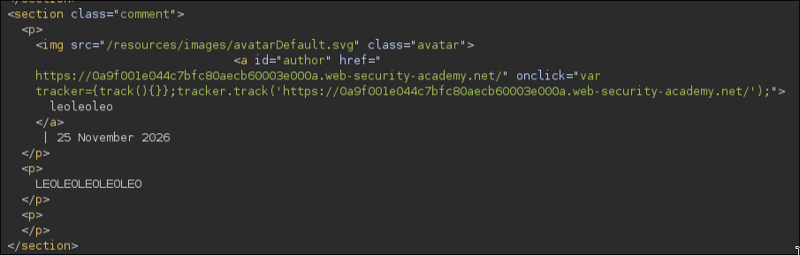
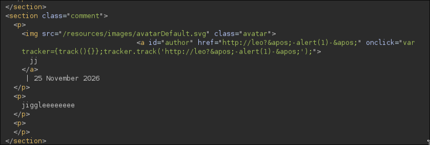

# Lab 03: Stored XSS into onclick Event Handler with Angle Brackets and Double Quotes HTML-Encoded and Single Quotes and Backslash Escaped


## 1. Lab Overview

This lab demonstrates a **Stored Cross-Site Scripting (XSS)** vulnerability in the comment functionality of a web application.

The application allows users to submit comments along with their name, email address, and website. The objective is to submit a comment that executes JavaScript when another user clicks the comment author's name.

The vulnerability occurs because the application inserts the user-controlled Website value into an HTML anchor element. More importantly, the same value is also inserted into a JavaScript string inside the anchor's `onclick` event handler.

The application applies several security measures:

- Angle brackets (`<` and `>`) are HTML-encoded.
- Double quotes (`"`) are HTML-encoded.
- Single quotes (`'`) are escaped using backslashes.
- Backslashes (`\`) are also escaped.

Despite these protections, the application does not properly account for HTML character references such as `&apos;`.

By using HTML entity decoding to introduce single quotes into the JavaScript context, it is possible to escape the existing string and execute an injected JavaScript expression.

## 2. Identifying the Vulnerable Input

While examining the comment functionality, I noticed that the application accepted a Website value alongside the commenter's name and comment.

After submitting a comment, I inspected the generated HTML and found that the Website value was inserted into the author's anchor element.

The relevant HTML structure looked like this:

```html
<a id="author"
   href="https://example.com/"
   onclick="var tracker={track(){}};tracker.track('https://example.com/');">
   Author Name
</a>
```

This revealed that the Website value was used in two different locations:

1. Inside the `href` attribute of the anchor element.
2. Inside a JavaScript string passed to the `tracker.track()` function within the `onclick` event handler.

The second location was particularly important because it placed user-controlled input inside executable JavaScript code.

### Screenshot: Original Generated HTML

The screenshot below shows the original HTML generated by the application after submitting a normal website value.

Notice that the website URL appears in both the `href` attribute and the JavaScript string inside the `onclick` handler.



## 3. Understanding the Vulnerable JavaScript Context

The relevant part of the event handler was:

```javascript
tracker.track('USER_INPUT');
```

The application placed the Website value inside a single-quoted JavaScript string.

Normally, user input should remain data inside that string. However, if an attacker can escape from the string and inject JavaScript expressions, the browser may execute the injected code when the event handler runs.

The challenge was that the application applied several filters:

| Character | Application's handling |
|---|---|
| `<` and `>` | HTML-encoded |
| `"` | HTML-encoded |
| `'` | Escaped using backslashes |
| `\` | Escaped using backslashes |

Therefore, directly submitting a payload containing literal single quotes would not work because the application escaped them.

The objective was to find another way to introduce single quotes into the JavaScript context without triggering the application's literal-character escaping.

## 4. Understanding the Filter Bypass: HTML Character References

The important observation was that the application escaped literal single quotes but did not prevent the use of HTML character references.

Instead of submitting literal single quotes, I used the HTML character reference:

```html
&apos;
```

This character reference represents a single quotation mark (`'`).

The browser decodes HTML character references while parsing HTML attribute values.

Consequently, when the browser processes the `onclick` attribute, `&apos;` becomes an actual single quote before the JavaScript event handler is compiled.

This allows quotation marks to be introduced into the JavaScript context without submitting literal single-quote characters that trigger the application's escaping mechanism.

### Understanding the Processing Order

The important sequence is:

1. The application receives the submitted Website value.
2. Its filtering mechanism processes the literal characters.
3. The application reflects the value into the HTML `onclick` attribute.
4. The browser parses the HTML attribute.
5. The browser decodes the `&apos;` character references into actual single quotes.
6. The resulting attribute value is interpreted as JavaScript when the event handler is compiled.
7. The injected quotation marks can terminate the original JavaScript string.

**Important:** This behavior depends on the application's filtering and encoding order. It is not a universal bypass that works against every website.

## 5. Final Payload

The successful payload submitted in the Website field was:

```text
http://leo?&apos;-alert(1)-&apos;
```

The payload contains two important parts.

### Part 1 — URL Prefix

```text
http://leo?
```

The application expected the Website field to contain a URL beginning with `http:` or `https:`.

This prefix satisfied the application's URL validation requirement.

The `?` character is also part of the submitted URL value.

### Part 2 — XSS Payload

```text
&apos;-alert(1)-&apos;
```

This is the actual XSS injection.

The HTML character references are decoded by the browser into single quotes, allowing the injected JavaScript expression to escape the original string context.

## 6. How the Payload Executes

The original JavaScript structure was:

```javascript
tracker.track('USER_INPUT');
```

After submitting the payload, the generated HTML contained:

```html
<a id="author"
   href="http://leo?&apos;-alert(1)-&apos;"
   onclick="var tracker={track(){}};tracker.track('http://leo?&apos;-alert(1)-&apos;');">
   Author Name
</a>
```

The important part is the JavaScript inside the `onclick` attribute.

### Step 1: HTML Entity Decoding

The browser decodes:

```html
&apos;
```

into:

```javascript
'
```

Therefore, the JavaScript event handler is conceptually equivalent to:

```javascript
tracker.track('http://leo?'-alert(1)-'');
```

### Step 2: Breaking Out of the Original String

The injected expression becomes:

```javascript
'http://leo?'-alert(1)-''
```

The first injected single quote terminates the original string.

This allows the JavaScript subtraction expression to be evaluated.

### Step 3: JavaScript Expression Evaluation

JavaScript evaluates the expression:

```javascript
'http://leo?'-alert(1)-''
```

The execution can be understood as follows:

1. `'http://leo?'` represents a string.
2. The `-` operator introduces a subtraction expression.
3. `alert(1)` is evaluated as part of the expression.
4. The final `-''` completes the expression syntactically.

The subtraction operation causes JavaScript to evaluate its operands. When it evaluates `alert(1)`, the alert function executes.

The arithmetic result is not important. The purpose of the expression is to execute the injected function while maintaining valid JavaScript syntax.

### Step 4: Triggering the Event Handler

The injected JavaScript is inside the anchor's `onclick` attribute.

Therefore, JavaScript executes when the comment author's name is clicked.

This is why submitting the comment alone does not trigger the alert. The stored payload executes when the affected event handler is activated.

## 7. Exploitation Steps

1. Open the lab and navigate to the comment functionality.
2. Enter a name and email address.
3. Enter a normal comment.
4. In the Website field, submit the following payload:

   ```text
   http://leo?&apos;-alert(1)-&apos;
   ```

5. Submit the comment.
6. Inspect the generated HTML if necessary.
7. Locate the newly submitted comment.
8. Click the comment author's name.
9. The `onclick` event handler executes the injected JavaScript and triggers `alert(1)`.
10. The lab is marked as solved.

## 8. Screenshots

### 8.1 Original HTML Structure

This screenshot shows the original comment author's anchor element before the payload was submitted.

The website value is inserted into both the `href` attribute and the JavaScript string inside the `onclick` handler.


### 8.2 HTML After Payload Injection

The screenshot below shows the generated HTML after submitting:

```text
http://leo?&apos;-alert(1)-&apos;
```

Notice that the `&apos;` character references appear inside both the `href` and `onclick` attributes.

The browser decodes these references when parsing the HTML, introducing the single quotes required to break out of the JavaScript string.



## 9. Root Cause

The root cause is the unsafe insertion of user-controlled Website input into a JavaScript string inside an HTML event-handler attribute.

The application attempts to filter dangerous characters, but its handling of literal quotation marks does not account for HTML character references.

The browser decodes those references while parsing the HTML attribute, resulting in quotation marks being introduced into the JavaScript source.

This allows an attacker to break out of the intended string context and inject an executable JavaScript expression.

The underlying issue is the use of user-controlled input inside an executable JavaScript context without appropriate context-aware output encoding.

## 10. Security Lessons and Mitigation

This lab demonstrates several important security concepts:

- **Stored XSS:** Malicious input is stored and executed when another user interacts with the affected page.
- **JavaScript Context Injection:** User-controlled input becomes dangerous when inserted into JavaScript code without context-appropriate protection.
- **HTML Character References:** Character references such as `&apos;` can be decoded by the browser during HTML parsing.
- **Event Handler Injection:** Attributes such as `onclick` contain JavaScript and must be treated as executable contexts.
- **Filter Bypass:** Blocking or escaping a few literal characters is not a reliable security strategy.

### Recommended Mitigations

1. Avoid inserting untrusted data directly into inline JavaScript event handlers.
2. Use context-aware output encoding rather than relying on character blacklists.
3. Prefer JavaScript event listeners, such as `addEventListener()`, instead of dynamically generated inline event handlers.
4. Validate URLs using an appropriate URL parser and allow only expected schemes.
5. Treat all user-controlled data as untrusted, even if it passes input validation.
6. Use a Content Security Policy (CSP) as an additional security layer.

## 11. Key Takeaway

The most important lesson from this lab is that **XSS exploitation depends on understanding the exact context in which user input is inserted**.

Here, the vulnerable input was not directly placed into ordinary HTML text. It was inserted into a JavaScript string inside an `onclick` attribute.

By understanding the application's filtering behavior and how the browser decodes HTML character references, I was able to bypass the escaping mechanism and execute JavaScript when the author's name was clicked.

The lab reinforced the importance of:

- Examining the generated HTML.
- Identifying the exact injection context.
- Understanding the application's input transformations.
- Understanding the browser's HTML parsing and entity-decoding behavior.
- Constructing a payload that remains syntactically valid after browser parsing.

**The key lesson is that protecting literal characters is not enough when the browser can decode alternative representations of those characters.**
