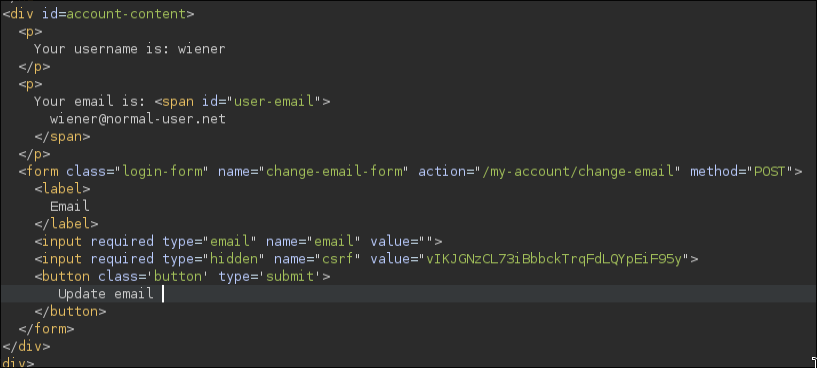
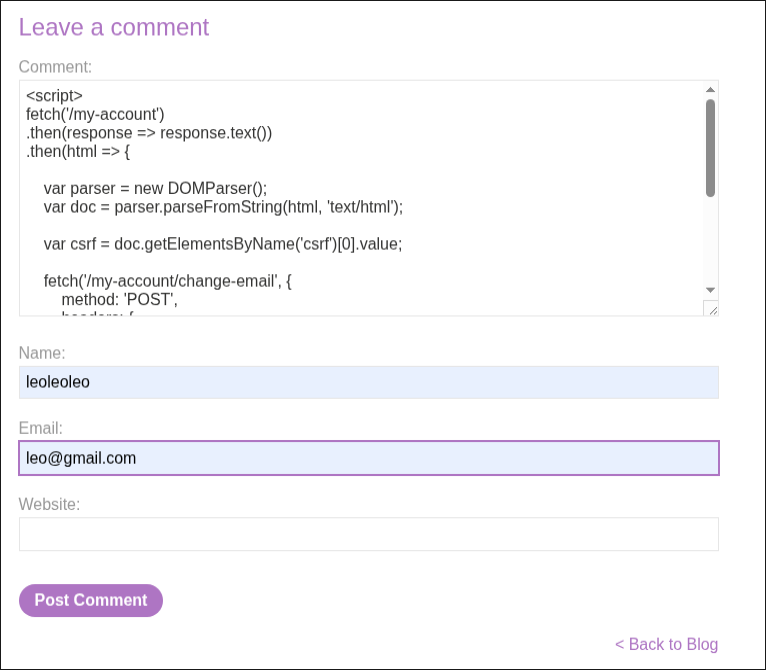

# Lab 06: Exploiting XSS to Bypass CSRF Defenses


## 1. Lab Overview

This lab demonstrates how a Stored Cross-Site Scripting (XSS) vulnerability can be used to bypass Cross-Site Request Forgery (CSRF) protections.

The application contains a stored XSS vulnerability in its blog comment functionality. The objective is to exploit this vulnerability to retrieve a CSRF token from the account page of a user who views the malicious comment.

The retrieved token can then be used to submit an authenticated request that changes the victim's email address.

### Lab Objective

1. Inject JavaScript through the blog comment functionality.
2. Make the victim's browser request their own account page.
3. Extract the CSRF token from the account page.
4. Submit a request to change the victim's email address using that token.
5. Successfully modify the victim's account email address.

**Credentials provided by the lab:**

| Username | Password |
|---|---|
| `wiener` | `peter` |

## 2. Understanding the Application's CSRF Protection

Before attempting the exploit, I examined the account page and inspected its HTML using the browser's developer tools.

I found that the email-change form contained a hidden CSRF token.

The relevant HTML structure looked like this:

```html
<form class="login-form"
      name="change-email-form"
      action="/my-account/change-email"
      method="POST">

    <label>Email</label>

    <input required
           type="email"
           name="email"
           value="">

    <input required
           type="hidden"
           name="csrf"
           value="CSRF_TOKEN">

    <button class="button" type="submit">
        Update email
    </button>
</form>
```

The important part is the hidden input:

```html
<input type="hidden" name="csrf" value="CSRF_TOKEN">
```

The application requires this token when processing an email-change request.

### Why Is the CSRF Token Required?

A CSRF token helps the application verify that a sensitive request originated from a legitimate interaction with the application.

An attacker who attempts to submit an unauthorized request from another website generally cannot simply guess or obtain the victim's token.

However, this lab introduces another vulnerability that changes the situation: Stored XSS.

If JavaScript executes in the context of the vulnerable website, it can make requests to that same website using the victim's authenticated browser session.

This makes it possible to retrieve the token from a page that would otherwise be protected.

## 3. Inspecting the Account Page

I inspected the account page and identified the hidden CSRF input.

The following screenshot shows the account form and its CSRF token in the HTML.



**Important observation:**

The CSRF token shown in this screenshot belongs to my own browser session. It is not the victim's token.

This distinction is important because CSRF tokens are associated with the user's session. A token obtained from my browser cannot simply be assumed to work for another user's authenticated session.

The exploit must retrieve the token while executing in the victim's browser.

## 4. Understanding the Stored XSS Injection Point

The blog comment functionality accepts user-controlled input and stores it for later display.

The comment form contains fields such as:

- Comment
- Name
- Email
- Website

Because the application contains a Stored XSS vulnerability, JavaScript injected through a comment can execute when another user views that comment.

The simulated victim visits the blog post after comments are submitted.

This creates the opportunity to execute JavaScript within the victim's authenticated session.



The key idea is that the injected JavaScript executes in the context of the vulnerable application, rather than in the attacker's separate browser session.

## 5. Exploitation Approach: Retrieving the Victim's CSRF Token

The first step is to retrieve the victim's account page.

The JavaScript can make a same-origin request:

```javascript
fetch('/my-account')
    .then(response => response.text())
```

Because the request is made from the vulnerable website in the victim's browser, the browser includes the victim's applicable session credentials.

The response contains the HTML of the victim's account page.

The next step is to parse that HTML and extract the hidden CSRF token.

Conceptually, the process is:

```javascript
var parser = new DOMParser();
var doc = parser.parseFromString(html, 'text/html');

var csrf = doc.getElementsByName('csrf')[0].value;
```

This is different from reading the CSRF input directly from the attacker's current page.

The token must come from the HTML returned by the victim's authenticated account page.

### Why Use `DOMParser`?

The response from `fetch()` is HTML represented as a string.

`DOMParser` converts that string into a document that can be queried using DOM methods.

This allows JavaScript to locate the hidden input:

```javascript
doc.getElementsByName('csrf')[0].value
```

The `.value` property retrieves the token stored in the input element.

## 6. Using the Retrieved Token to Change the Email Address

Once the victim's CSRF token has been extracted, the next step is to submit a POST request to the email-change endpoint.

The endpoint identified in the account form is:

```text
/my-account/change-email
```

The request must contain the expected form parameters, including:

- `email` — the new email address.
- `csrf` — the token retrieved from the victim's account page.

The general request structure is:

```javascript
fetch('/my-account/change-email', {
    method: 'POST',
    headers: {
        'Content-Type': 'application/x-www-form-urlencoded'
    },
    body: new URLSearchParams({
        email: 'new-email@example.com',
        csrf: csrf
    })
});
```

The important detail is that the request uses the token extracted from the victim's account page.

Since the request is made from the victim's browser, it uses the victim's authenticated session.

## 7. Complete Attack Flow

The overall attack can be understood as the following sequence:

```text
Attacker submits a malicious blog comment
                 |
                 v
       Application stores the comment
                 |
                 v
        Victim visits the blog post
                 |
                 v
       Injected JavaScript executes
                 |
                 v
       JavaScript requests /my-account
                 |
                 v
     Victim's authenticated page is returned
                 |
                 v
       JavaScript parses the HTML response
                 |
                 v
       Victim's CSRF token is extracted
                 |
                 v
       POST request to /my-account/change-email
                 |
                 v
       Request includes the victim's CSRF token
                 |
                 v
       Victim's email address is changed
```

The attack combines two vulnerabilities:

1. **Stored XSS:** Allows attacker-controlled JavaScript to execute in another user's browser.
2. **CSRF protection bypass:** The injected JavaScript retrieves the token required to submit a sensitive authenticated request.

## 8. Why This Attack Works

A CSRF token is designed to prevent unauthorized websites from submitting sensitive requests on behalf of authenticated users.

However, the same-origin policy does not prevent JavaScript executing on a website from reading responses from that same origin.

In this lab:

- The injected JavaScript executes on the vulnerable website.
- It requests the victim's account page from the same origin.
- The browser makes the request using the victim's authenticated session.
- The JavaScript can read the returned HTML.
- It extracts the CSRF token and uses it in another same-origin request.

Therefore, the attacker does not need to guess the token or obtain it from their own browser.

The Stored XSS vulnerability provides the ability to execute JavaScript with the victim's origin privileges.

## 9. Important Observations

### The Attacker's CSRF Token Is Not the Victim's Token

The token visible in my browser's developer tools belongs to my own authenticated session.

It should not be copied into the exploit and treated as the victim's token.

Instead, the injected JavaScript must retrieve the token dynamically from the victim's account page.

### Same-Origin Requests

The requests to `/my-account` and `/my-account/change-email` are made to the same origin as the page executing the injected JavaScript.

This is what allows the script to read the account page response and extract the token.

### XSS Can Defeat CSRF Defenses

CSRF tokens are useful against cross-origin request forgery, but they do not protect an application from JavaScript already executing within its own origin.

This is why preventing XSS is essential even when an application has CSRF protection.

## 10. Root Cause

The underlying issue is the Stored XSS vulnerability in the blog comment functionality.

The application allows attacker-controlled JavaScript to execute in the context of the website.

Once JavaScript executes within the application's origin, it can interact with authenticated pages and perform actions available to the logged-in user.

The CSRF token does not provide protection against this situation because the injected script can retrieve the token directly from the victim's account page.

## 11. Security Lessons and Mitigation

This lab demonstrates why XSS and CSRF must be considered together.

Recommended security measures include:

1. **Prevent Stored XSS:** Apply context-aware output encoding to user-generated content.
2. **Use Safe DOM APIs:** Avoid inserting untrusted input into executable HTML contexts.
3. **Avoid Inline JavaScript:** Use safer event-handling mechanisms instead of inline event handlers.
4. **Implement CSRF Protection:** Continue using unpredictable, session-bound CSRF tokens for sensitive state-changing requests.
5. **Use SameSite Cookies:** Configure session cookies with an appropriate `SameSite` policy as an additional CSRF defense.
6. **Use Content Security Policy:** Apply a restrictive CSP to reduce the impact of script injection.

**Important:** CSRF tokens are not a replacement for XSS prevention. If an attacker can execute JavaScript in the application's origin, that script may be able to access the same resources available to the legitimate user.

## 12. Key Takeaway

The most important lesson from this lab is that a CSRF token does not protect an application from an attacker who already has JavaScript execution within the application's origin.

The Stored XSS vulnerability allows the injected script to request the victim's account page, retrieve the victim's CSRF token, and use it to submit an authenticated email-change request.

This demonstrates how one vulnerability can undermine another security mechanism.

**Final concept to remember:**

> CSRF protection can stop unauthorized cross-origin requests, but it cannot reliably defend against malicious JavaScript executing within the application's own origin.
